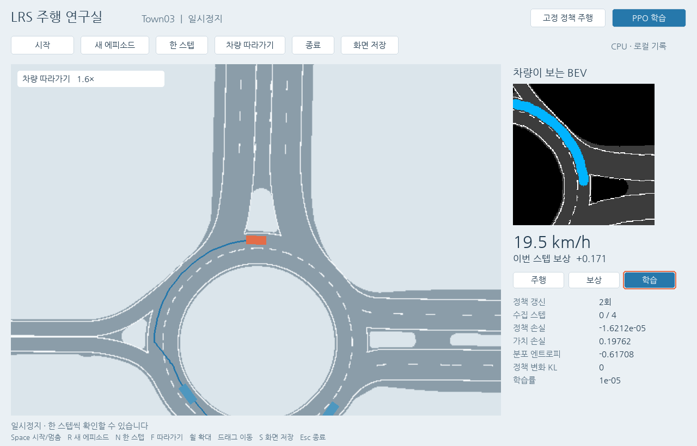

# LRS: Low Resource Simulation — LRS_V1

**English** | [한국어](docs/README_ko.md)



An offline BEV driving simulator with fixed Roach policy inference, a separate ego PPO trainer, and a Korean Pygame interface. No wandb installation, login, or upload is required. The existing map ZIP in `sim_using_data/` is preserved; runtime map files must be extracted and arranged separately. Original models and historical run records remain local and are excluded from new commits.

**Status: historical short execution and contract checks passed in the recorded local environment. The short learned policy did not improve on the original policy. Long training and full-route safety remain unvalidated. Passing the new preparation checker does not validate driving or training.**

## Required preparation

A fresh clone does not contain a virtual environment, extracted maps, policy weights, or private settings. Follow [Asset and environment setup](docs/ASSET_SETUP.md) first. The original Roach checkpoint's public source remains unresolved: the GUI, simulator, and PPO trainer cannot run without it. `--from-scratch` still requires the original NPC policy checkpoint.

```bash
cp gui_settings.example.json gui_settings.json
```

The private `gui_settings.json` is ignored by Git. Set its font path to an installed Korean font. `requirements.txt` lists direct core dependencies; it is not a verified installation specification or lockfile. OpenCV 4.13 metadata requires NumPy >=2, but the recorded environment used NumPy 1.26.4. Clean installation and NumPy 2 checkpoint compatibility have not been tested. The environment commands below require a compatible existing Python environment.

Every `run.sh` invocation now checks the selected town's required files, the original NPC checkpoint's fixed SHA256, the policy YAML, and the project `.venv` before starting the requested Python script. Dependency imports run in `.venv/bin/python`, not the checker's host environment. The default GUI also requires valid private settings and an existing font file. Failures stop execution with Korean diagnostics and repair commands; no asset is downloaded or extracted automatically.

## Quick start

```bash
# Preparation check only; does not start the GUI or run a policy
./run.sh --check

# Launch after preparing all required assets and dependencies
./run.sh
```

After preparation checks pass, the Pygame window opens **paused**. Press Start to run the fixed policy. Select PPO training in the upper-right corner to switch to policy collection and updates, then press Start. The GUI uses CPU.

Use the same script and arguments for a command-specific preparation check. `--town` (including `--town=Town04`) selects that town's files; Town04/Town05 need four additional layered-map files. `TOWN` supplies the default only for `simulate.py` and `train_w.py`. Headless simulation and CLI PPO do not require GUI settings or a font.

```bash
./run.sh --check simulate.py --headless --town Town03
./run.sh --check ppo_train.py --town Town03 --from-scratch

# Standard-library-only diagnostics, including when .venv does not exist yet
python3 preflight.py simulate.py --headless --town Town03
```

Exit status 0 means the preparation checks passed; a nonzero status blocks `run.sh`. This confirms file presence/readability, the original hash, and dependency imports/selected APIs. It does not deserialize checkpoints, validate map contents or package-wide version compatibility, initialize CUDA/display devices, or demonstrate successful driving or learning. The public acquisition path for the original checkpoint remains unresolved.

```bash
# Explicit GUI entrypoint
./run.sh gui.py

# Headless fixed-policy simulation: 60 steps, no learning
./run.sh simulate.py --headless --steps 60 --device cpu

# Short PPO training and independent-seed evaluation
./run.sh ppo_train.py --steps 64 --rollout 32 --epochs 2 --batch-size 16 \
  --episode-steps 128 --eval-steps 32 --device cpu

# Bounded CUDA execution check
./run.sh ppo_train.py --steps 4 --rollout 4 --epochs 1 --batch-size 4 \
  --episode-steps 8 --skip-eval --device cuda
```

The default `train_w.py` command also opens the new GUI. Use `ppo_train.py` for new training. Its retained `train()` and `experimental_main()` functions are historical comparison code, outside the recommended execution path. No five-million-step training run starts automatically.

## Controls and outputs

- Start/pause: button or Space. Pausing stops physics, policy collection, and updates.
- New episode: button or R. Recreates the route with the same seed and resets vehicle state, while retaining weights already updated in the GUI.
- Single step: button or N. Advances one step while paused.
- Map: mouse wheel to zoom; drag or arrow keys to pan; F to follow the ego vehicle.
- Screenshot: button or S. Saves only the current window as a PNG.
- Keyboard focus: Tab and Enter. Exit: button, window close, or Esc.

The default output directory is `roach_run/<Town>/<timestamp>/`. Use `--output` to choose a new output directory. The GUI saves `metrics.jsonl`, `summary.json`, screenshots, and `ppo_latest.pth` after each PPO update. Headless simulation saves actual BEV video to `simulation.mp4`. CLI training saves `ppo_final.pth`, configuration, metrics, and independent evaluation results. Existing `roach/results.log` and the original checkpoint are not overwritten.

The default window is 1280×820, with a minimum of 1024×760. Configure font and size in your local `gui_settings.json`, copied from `gui_settings.example.json`. See [GUI guide](docs/UI_GUIDE.md) for details and recorded screenshots.

## Structure and observations

| Path | Role |
| --- | --- |
| `gui.py`, `simulate.py` | Korean GUI and fixed-policy simulation |
| `preflight.py`, `run.sh`, `roach/utils/asset_manifest.py` | Preparation gate and shared original-checkpoint identity |
| `ppo_train.py`, `roach/ppo.py` | Ego PPO collection, updates, checkpoint output, evaluation |
| `task_reward.py`, `reward_config.json` | Task rewards and terminated/truncated contract |
| `loop.py`, `sim/` | Offline dynamics, routes, pedestrians, traffic lights, BEV |
| `roach/models/`, `roach/utils/checkpoint.py` | Original policy and restricted checkpoint loading |
| `validation/tests/`, `validation/no_tracker/` | Reproduction tests and tracker-import blocking |
| `env.py`, `model/ppo.py`, `data_gan.py` | Earlier variants; full execution not revalidated |

`birdview` is float32 with shape `(15, 192, 192)` and range 0–255; the policy normalizes it by 255. `state` contains six control and ego-frame velocity values. Default entrypoints advance simulation by 1/30 second per step.

## PPO and rewards

Collection, old log probabilities, value estimates, bootstrap, and updates use the same `PPOAgent`. Checks compared the original Roach head semantics and shapes, BEV `/255` normalization, Softplus Beta distribution, and deterministic actions. Acceleration/braking and steering form two actions in `[-1, 1]`. Log probabilities include the range-transform Jacobian.

`TaskEnv` retains the existing simulation and observations while providing separate training rewards and a five-element step return. Fixed-policy simulation retains its original rewards.

| Reward signal | Units and behavior |
| --- | --- |
| New route progress | Rewards newly reached route distance in meters; repeated travel over the same distance earns no additional progress reward |
| Time, route/heading error | Costs proportional to actual `FIXED_DT`, normally 1/30 second |
| Speeding, reverse motion, unnecessary stopping | Prevents rewards from merely increasing speed or remaining stopped near the route center |
| Control changes | Squared change costs for consecutive acceleration and steering values |
| Collision, road/route departure, red-light crossing, prolonged standstill | Terminates with one prioritized failure cost; removes same-step progress/completion bonuses |
| Route completion | Bonus and termination require endpoint distance, route error, and heading conditions together |

Rewards use actual simulated position, route, collision/road masks, traffic-light IDs and stop lines, and NPC positions. No extra sensors are assumed. When stopping is required by a red light or a nearby NPC ahead, unnecessary-stop costs and standstill termination are waived without awarding a positive stopping reward. Each step's reward components and raw task metrics are logged to JSONL.

```bash
# After editing reward_config.json
./run.sh ppo_train.py --steps 64 --reward-config reward_config.json

# Resume from saved weights; optimizer state is recreated
./run.sh ppo_train.py --steps 64 --checkpoint roach_run/<run-directory>/ppo_final.pth
```

`reward_config.json` contains the full default reward configuration. CLI `--episode-steps`, when supplied, overrides the file's step limit. Evaluation uses a separate `--eval-steps` limit. The GUI uses default reward settings and displays the actual components in its reward tab. `--from-scratch` initializes new ego PPO weights; NPCs continue using the original Roach checkpoint.

True terminal states disable value bootstrap. Time-limit truncation uses the last observation's value. GAE stops at episode boundaries. For consistency between CUDA collection and batch recomputation, cuDNN TF32 is disabled within the training process. Drivers and system settings are not changed.

## Validation and current limits

Previously recorded checks cover CPU 64 steps/two updates, CUDA four steps/one update, original policy equivalence, pre-update probability ratios near one, finite loss/KL/log probabilities, 34 changed parameter tensors, and exact save/reload equality. Twelve reward counterexample and termination/bootstrap tests passed, along with repeated GUI operation, recovery, resize, close, and reopen. Validation blocked wandb imports. These historical results are separate from the preparation checker.

Independent seeds 101/102/103 were evaluated for at most 32 steps each, about 1.07 seconds. Mean returns were 3.463 for the learned policy and 3.851 for the original fixed policy: **this short training did not improve on the original policy.**

| Policy | Mean task return | Mean new route progress | Route completions |
| --- | ---: | ---: | ---: |
| 64-step learned | 3.463 | 5.615 m | 0/3 |
| Original fixed | 3.851 | 6.027 m | 0/3 |
| Uniform random | -5.144 | 3.658 m | 0/3 |

This evaluation is too short to establish full-route completion or collision safety. Long training, full-route evaluation, a real CARLA server, and vehicle control were not run.

See [Validation results](docs/VALIDATION.md) for execution results, corrected failures, and evaluation tables. Raw logs and environment dumps are excluded from public distribution.

```bash
# Preparation checker and launcher regression tests: standard library only
python3 validation/tests/test_preflight.py

# Existing contracts require compatible dependencies but do not load map/weight assets
CUDA_VISIBLE_DEVICES='' .venv/bin/python -B validation/tests/test_contracts.py

# Actual simulation regression additionally requires original checkpoint and maps
CUDA_VISIBLE_DEVICES='' ./run.sh validation/tests/test_regression.py

# Brief control check in an actual desktop Pygame window
CUDA_VISIBLE_DEVICES='' SDL_AUDIODRIVER=dummy \
  PYTHONPATH=validation/no_tracker:. ./run.sh validation/tests/test_gui.py
```

Preparation tests use synthetic files and dependency stand-ins in temporary virtual environments. They cover missing/empty/nested maps, Town04/Town05 layers, checkpoint/hash errors, the retained NPC requirement with `--from-scratch` or custom ego weights, missing/broken dependency imports, and launch blocking/argument forwarding. They do not exercise the real Roach policy, driving, or PPO updates. Existing simulation/GUI regressions still need the real assets and compatible packages.

## Environment setup

Complete checkpoint, map, environment, and font preparation in [Asset and environment setup](docs/ASSET_SETUP.md). With a compatible existing Python 3.9 environment, create a project virtual environment from the repository root as follows. A clean installation remains untested.

```bash
python -m venv --system-site-packages .venv
.venv/bin/python -m pip install --no-deps -r requirements-local.txt
cp gui_settings.example.json gui_settings.json
```

Prepare the original checkpoint separately as a regular file at `roach/log/ckpt_11833344.pth`. Its public source remains unresolved. Only the exact path and fixed SHA256 permit scoped Gym/NumPy metadata types, while retaining `weights_only=True`. A checkpoint symlink does not satisfy the restricted loader's fixed-path condition. No exception applies to other paths/hashes, and there is no unrestricted-pickle retry. `run.sh` requires a working project `.venv` with Python 3.9 or later; run `./run.sh --check` to inspect preparation before launching.

## Public source scope

NPCs in `loop.py` share a fixed Roach policy and perform deterministic batched inference. PPO updates the ego policy; pedestrians use scripted behavior. BEV is a privileged observation generated from maps and simulated actor states, rather than camera-derived perception. NPU integration, training convergence, data-quality gains, and lower resource cost are unverified goals in this version. Earlier `env.py`, `model/ppo.py`, `data_gan.py`, and Roach integrations remain for comparison; full execution was not revalidated. Some earlier wrappers/criteria require an external `carla_gym` package that is not bundled.

[Validation results](docs/VALIDATION.md) describe runs already completed in the original environment. Git preparation did not rerun the GUI or training. Public files include validation summaries, tests, and GUI screenshots limited to the project window. Raw logs, environment dumps, generated models, and videos remain local and are excluded from public distribution. The existing [LICENSE](LICENSE) is retained.
